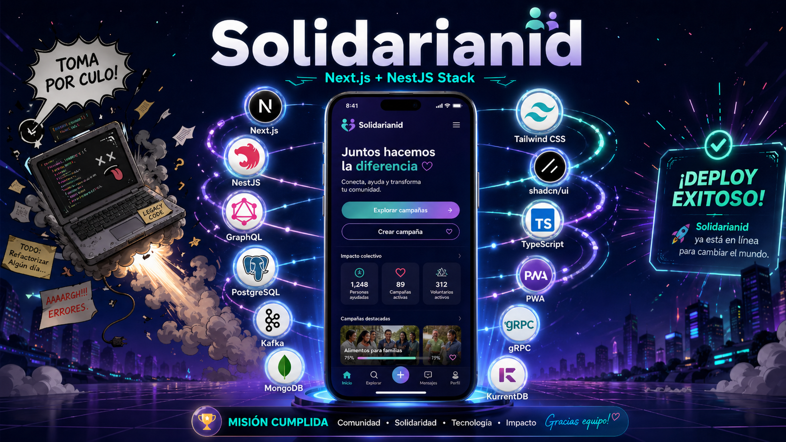
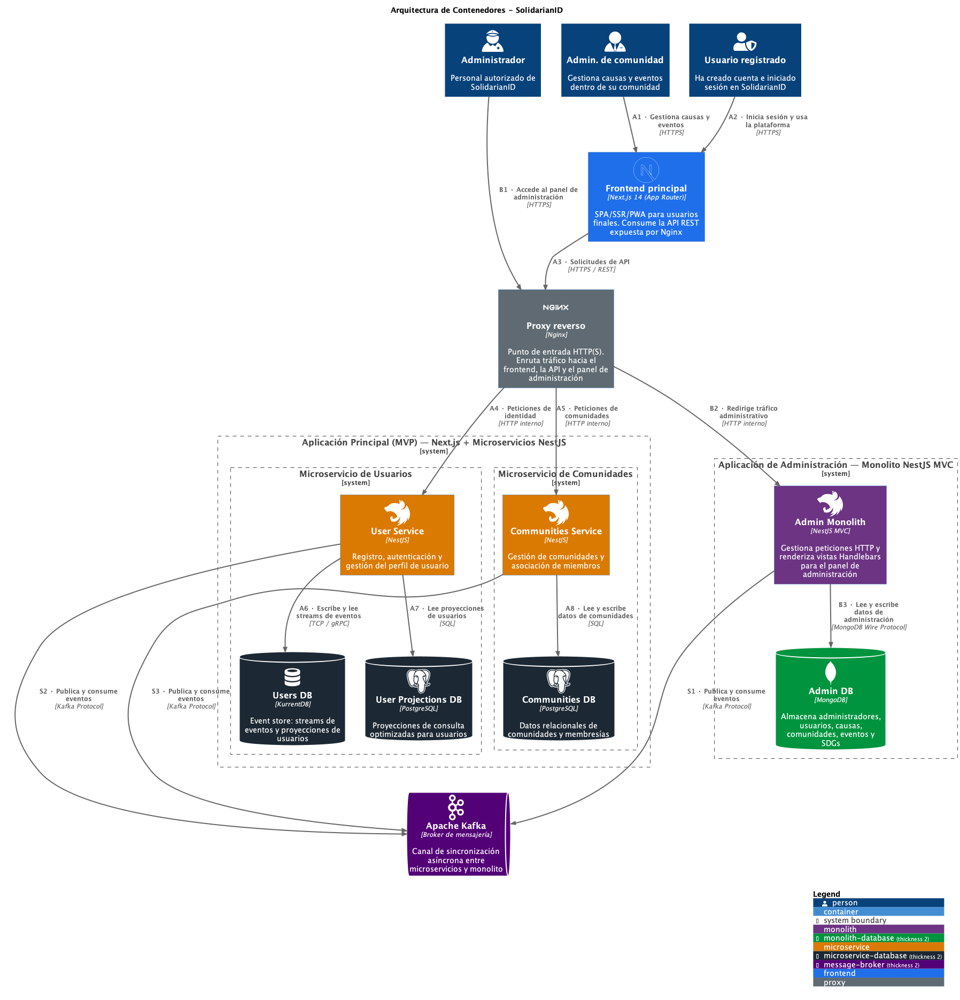

<p align="center">
  
</p>

<h1 align="center">SolidarianID</h1>

<p align="center">
  <strong>Plataforma de gestión de voluntariado y causas solidarias del grupo 3</strong>
</p>

<p align="center">
  <a href="https://github.com/fsoladur/SolidarianID">
    
  </a>
  <a href="https://github.com/fsoladur/SolidarianID">
    
  </a>
</p>

<p align="center">
  
  
  
  
  
  
</p>

---



---

> [!NOTE]
> En la carpeta `./memorias` se pueden encontrar todas las documentaciones de este proyecto.

## Autores

<table>
  <tr>
    <td align="center">
      <a href="https://github.com/fsoladur">
        <br />
        <sub><b>Fabián Sola</b></sub>
      </a>
    </td>
    <td align="center">
      <a href="https://github.com/pabloperissolano">
        <br />
        <sub><b>Pablo Peris</b></sub>
      </a>
    </td>
    <td align="center">
      <a href="https://github.com/Sergiorosliarte">
        <br />
        <sub><b>Sergio Ros</b></sub>
      </a>
    </td>
    <td align="center">
      <a href="https://github.com/elmanueh">
        <br />
        <sub><b>Manuel Bernabé</b></sub>
      </a>
    </td>
    <td align="center">
      <a href="https://github.com/Zerep0">
        <br />
        <sub><b>Antonio Pérez</b></sub>
      </a>
    </td>
  </tr>
</table>

---

## Tabla de Contenidos

- [Autores](#autores)
- [Tabla de Contenidos](#tabla-de-contenidos)
- [Descripción](#descripción)
- [Arquitectura](#arquitectura)
- [Despliegue en local](#despliegue-en-local)
  - [Requisitos previos](#requisitos-previos)
  - [Clona el repositorio](#clona-el-repositorio)
  - [Modo Producción](#modo-producción)
    - [1. Configurar variables de entorno](#1-configurar-variables-de-entorno)
    - [2. Iniciar el entorno](#2-iniciar-el-entorno)
    - [3. Generación de datos ficticios](#3-generación-de-datos-ficticios)
    - [4. Detener el entorno](#4-detener-el-entorno)
- [Variables de Entorno](#variables-de-entorno)
- [Uso](#uso)
  - [Credenciales de prueba](#credenciales-de-prueba)
  - [Endpoints principales](#endpoints-principales)
- [Testing](#testing)
- [Stack Tecnológico](#stack-tecnológico)
  - [Tecnologías Principales](#tecnologías-principales)
  - [Librerías destacadas](#librerías-destacadas)
- [Créditos y Licencia](#créditos-y-licencia)
  - [Licencia](#licencia)

---

## Descripción

**SolidarianID** es una plataforma integral para la gestión de voluntariado y causas solidarias, desarrollada para la organización "Voluntarios Sin Fronteras". El sistema permite:

- **Identidad Digital Única**: Cada voluntario cuenta con un ID único y un historial de participación.
- **Gestión de Comunidades**: Creación y administración de grupos con intereses comunes.
- **Causas Solidarias**: Vinculadas a los Objetivos de Desarrollo Sostenible (ODS) de la ONU.
- **Acciones Benéficas**: Proyectos concretos con objetivos cuantificables.
- **Eventos**: Actividades presenciales para dar visibilidad a las causas.
- **Panel de Administración**: Interfaz web para la gestión y validación de solicitudes.

El proyecto sigue los principios de **Clean Architecture**, **Hexagonal Architecture** y **Domain-Driven Design (DDD)** y comunicación por eventos mediante **Apache Kafka**.

---

## Arquitectura

El sistema cumple la siguiente arquitectura:



---

## Despliegue en local

### Requisitos previos

- **Node.js** >= 20.x
- **npm** >= 10.x
- **Docker** y **Docker Compose**
- **Git**
- **pnpm** >= 10.x

> [!WARNING]
>
> **¡Importante!** Antes de iniciar la aplicación, se recomienda eliminar todos los volúmenes de Docker utilizados si es la segunda vez que se despliega el sistema en tu ordenador
>
> ```bash
> docker compose down -v
> docker volume prune -f
> ```

### Clona el repositorio

```bash
git clone https://github.com/fsoladur/SolidarianID.git
cd SolidarianID
```

---

### Modo Producción

El modo producción despliega todos los servicios como contenedores Docker excepto el frontend en next.js que se ejecuta en local para facilitar el desarrollo y testing.

> [!IMPORTANT]
> Es crucial que se sigan los pasos en el orden indicado para evitar problemas de configuración y despliegue.

#### 1. Configurar variables de entorno

En la entrega de la asignatura se han proporcionado los archivos `.env` para cada aplicación.

En el caso del backend de la asignatura `.env.production` dicho fichero ha de ir en la carpeta `solidarian-id/.env.production`. 

En el caso del frontend de la asignatura `.env` dicho fichero ha de ir en la carpeta `solidarian-frontend/.env`.


#### 2. Iniciar el entorno

**Para iniciar todo lo relativo al backend:**

```bash
cd solidarian-id
npm run docker
npm run docker:mac # Solo para usuarios de MacOS para evitar problemas con la imagen de KurrentDB que no es multiplataforma 
```

**Para iniciar lo relativo al frontend:**

```bash
cd solidarian-frontend
npm install
npm run launch
```

**Si eres *pnpm lover* como nosotros, puedes usar:**

```bash
cd solidarian-frontend
pnpm install
pnpm launch
```

#### 3. Generación de datos ficticios

Para generar datos ficticios en el backend, puedes ejecutar el siguiente comando:

```bash
cd solidarian-id
npm run db:seed
```

De esta forma se poblarán las bases de datos con datos de prueba para facilitar el testing y la exploración de la plataforma.

Se podrá consultar cómo se ve la interfaz con datos en el puerto `http://localhost:3000` para ver el frontend de administración que desarrollamos en el primer cuatrimestre y en el puerto `http://localhost:4000` para ver el frontend de usuario que hemos desarrollado en el segundo cuatrimestre. Ten en cuenta que te harán falta las credenciales de administrador para acceder al panel de administración que aquí se adjuntan:

| #   | Nombre                  | Email                               | Teléfono     | Contraseña       |
| --- | ----------------------- | ----------------------------------- | ------------ | ---------------- |
| 1   | Sergio García Martínez  | `sergio.garcia@solidarianid.org`    | +34612345001 | `Admin2024!Pass` |
| 2   | Fabián Rodríguez López  | `fabian.rodriguez@solidarianid.org` | +34612345002 | `Admin2024!Pass` |
| 3   | Pablo Fernández Sánchez | `pablo.fernandez@solidarianid.org`  | +34612345003 | `Admin2024!Pass` |
| 4   | Antonio Martín González | `antonio.martin@solidarianid.org`   | +34612345004 | `Admin2024!Pass` |
| 5   | Manuel Pérez Ruiz       | `manuel.perez@solidarianid.org`     | +34612345005 | `Admin2024!Pass` |

Para probar el frontend de usuario y solicitar la creación de una comunidad, causa o acción. Deberás tras solicitar la creación iniciar sesión en la aplicación de administración y aceptar o denegar la solicitud para que se vea reflejada en el frontend de usuario. Ya que como se ve en el diagrama de arquitectura, ambas aplicaciones están sincronizadas a través de eventos en Kafka y no a través de consultas directas a la base de datos. Quitando este ínfimo apunte puedes probar la aplicación con total normalidad.

#### 4. Detener el entorno

Para detener todo lo relativo al backend:

```bash
npm run docker:down
```

Para detener todo lo relativo al frontend:

Ctrl + C para detener el proceso de next.js

---

## Variables de Entorno

| Variable           | Descripción                                                  |
| ------------------ | ------------------------------------------------------------ |
| `NODE_ENV`         | Entorno de ejecución (`development` / `production` / `test`) |
| `SESSION_SECRET`   | Clave secreta para las sesiones HTTP                         |
| `ADMIN_PORT`       | Puerto del servicio de administración                        |
| `USERS_PORT`       | Puerto del servicio de usuarios                              |
| `COMMUNITIES_PORT` | Puerto del servicio de comunidades                           |
| `POSTGRES_*`       | Configuración de PostgreSQL                                  |
| `MONGO_*`          | Configuración de MongoDB                                     |
| `KAFKA_*`          | Configuración de Apache Kafka                                |

---

## Uso

### Credenciales de prueba

Una vez inicializado el sistema, puedes acceder con las siguientes credenciales de administrador:

| Email                               | Contraseña       |
| ----------------------------------- | ---------------- |
| `manuel.perez@solidarianid.org`     | `Admin2024!Pass` |
| `sergio.garcia@solidarianid.org`    | `Admin2024!Pass` |
| `fabian.rodriguez@solidarianid.org` | `Admin2024!Pass` |

### Endpoints principales

- **Panel Admin**: `http://localhost:3000/login`
- **API Users**: `http://localhost:3001/api`
- **API Communities**: `http://localhost:3002/api`
- **Swagger Documentation**: `http://localhost:300X/api/docs` (cuando esté habilitado)

---

## Testing

El proyecto incluye una estrategia de testing completa:

```bash
# Tests unitarios
npm run test

# Tests unitarios por servicio
npm run test:admin
npm run test:users
npm run test:communities

# Tests E2E
npm run test:e2e

# Tests de integración
npm run test:integration

# Tests de mutación (Stryker)
npm run test:mutation

# Cobertura completa
npm run test:all:coverage
```

---

## Stack Tecnológico

### Tecnologías Principales

| Tecnología       | Versión | Descripción                                            |
| ---------------- | ------- | ------------------------------------------------------ |
| **NestJS**       | 11.0    | Framework backend modular para Node.js                 |
| **TypeScript**   | 5.9     | Lenguaje de programación tipado                        |
| **MongoDB**      | 9.0     | Base de datos NoSQL para documentos flexibles          |
| **PostgreSQL**   | 16      | Base de datos relacional para datos transaccionales    |
| **Apache Kafka** | Latest  | Broker de mensajería para eventos entre microservicios |
| **Docker**       | Latest  | Contenedorización de servicios                         |
| **Handlebars**   | 8.0     | Motor de plantillas para el panel admin                |
| **TailwindCSS**  | 4.1     | Framework CSS utility-first                            |
| **Jest**         | 30.0    | Framework de testing                                   |
| **Cypress**      | 15.8    | Testing E2E                                            |

### Librerías destacadas

- **class-validator** / **class-transformer**: Validación de DTOs
- **Mongoose**: ODM para MongoDB
- **TypeORM**: ORM para PostgreSQL
- **KafkaJS**: Cliente de Kafka para Node.js
- **bcrypt**: Hashing de contraseñas
- **express-session**: Gestión de sesiones HTTP
- **Chart.js**: Visualización de métricas
- **PDFKit**: Generación de informes PDF

---

## Créditos y Licencia

**SolidarianID** ha sido desarrollado como parte de un Trabajo conjunto entre varias asignaturas en el contexto del Máster de Ingeniería del Software de la Universidad de Murcia.

### Licencia

Este proyecto está bajo la licencia especificada en el archivo [LICENSE](./LICENSE).

---

<p align="center">
  <strong>🌍 Voluntarios Sin Fronteras - SolidarianID Grupo 3© 2026</strong>
</p>
